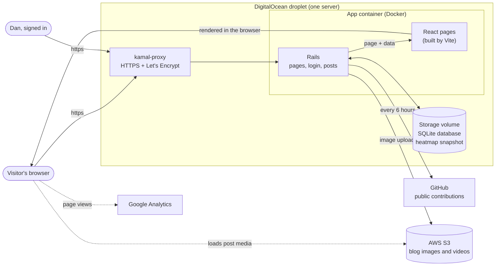
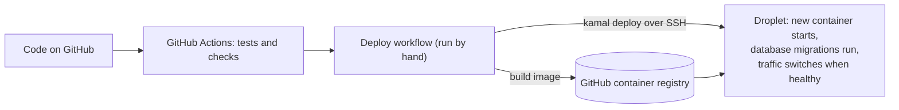

# How daniel-hillman.com works

A high-level map of the site. Update it when the moving parts change.

## The pieces

| Piece | What it does |
|---|---|
| **kamal-proxy** | Receives all traffic, handles HTTPS certificates, and switches to a new version only once it's healthy. |
| **Rails** | Decides which page to show and what data it needs, handles the admin login, and saves posts. |
| **React** | Draws every page in the browser. Rails hands it the data through Inertia, so there's no separate API. |
| **Vite** | Builds the React code and styles into small files during the Docker build. |
| **SQLite** | The database: posts, the admin user, and site settings. A single file on the server's storage volume. |
| **GitHub** | Source of the contribution heatmap, refreshed every 6 hours and cached on the server. |
| **S3** | Holds blog images and videos. New images are uploaded from the post editor. |
| **GitHub Actions** | Runs the tests on every push and deploys when the Deploy workflow is run. |

## Themes

The site has a few color themes (Solarized, Gruvbox, Catppuccin and Classic), each with a light and a dark mode.

- **A theme is a named list of colors**, plus fonts and corner sizes. The styles never use actual colors; they say "background", "link", "accent", and the browser looks those up in the active list. The lists live in `app/frontend/entrypoints/themes.css`.
- **Two labels on the page pick the list.** `data-scheme` (which theme) is chosen in the admin and saved with the other site settings. The server writes it into the page before it reaches the browser, so there's no flicker. `data-theme` (light or dark) is each visitor's own choice from the sun/moon button, remembered in their browser.
- **Terminal touches** (numbered tabs, the `##` headings, the statusline at the bottom, line numbers) only appear in the terminal-style themes. In the code they're marked with `term:`; Classic turns them all off.
- **Adding a theme** means adding its name to `SiteSetting::THEMES` and a light and a dark block of colors to `themes.css`.

More detail: [README](../README.md) for development and deploying, and
[infra/README.md](../infra/README.md) for the server setup.
